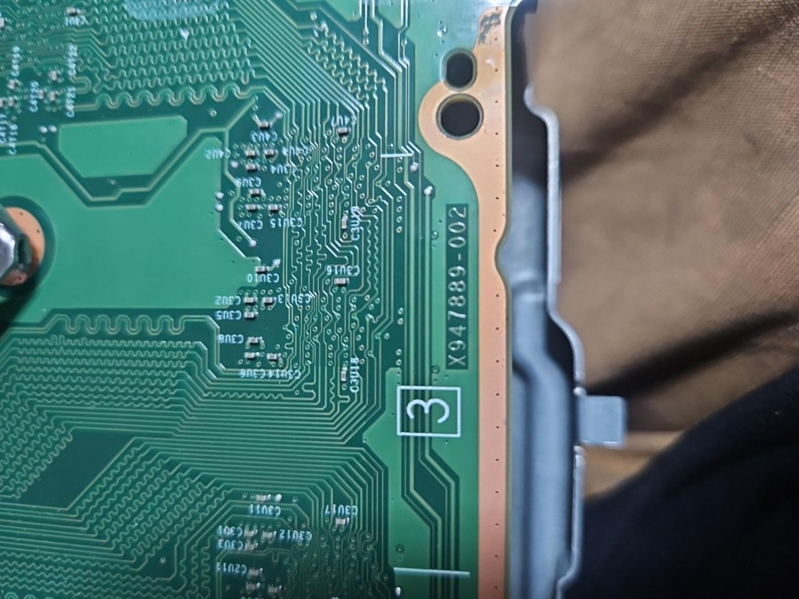
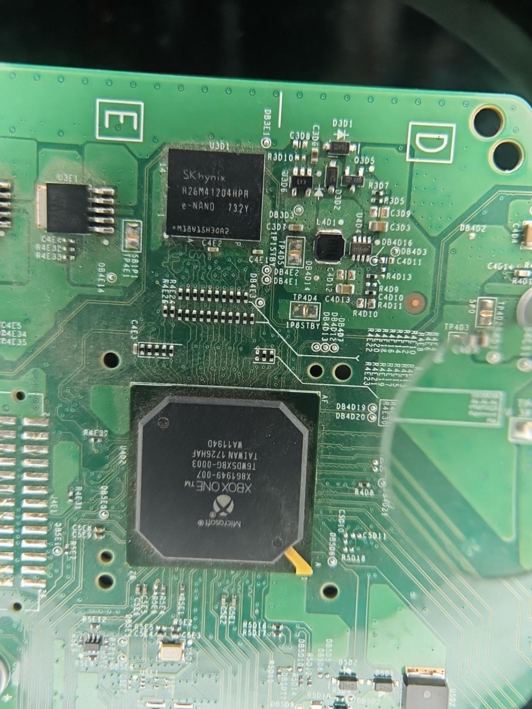
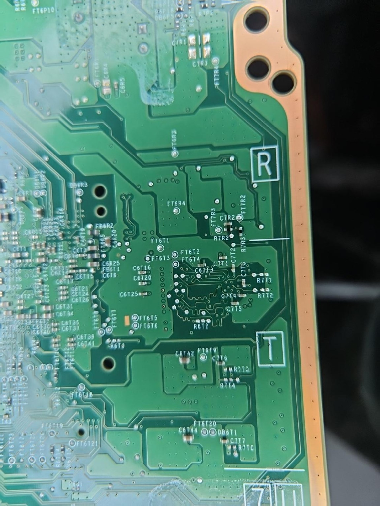
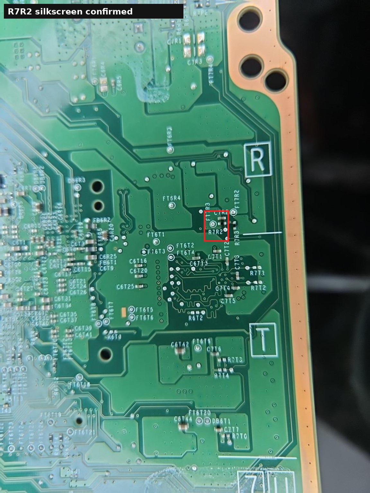
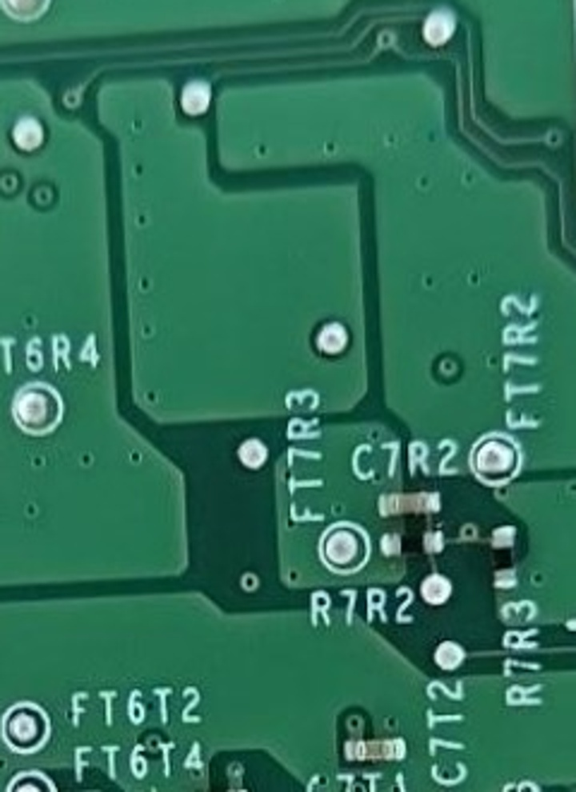

# Hardware identification and photo evidence

## Confirmed on the photographed hardware

| Observation | Evidence | Limit |
|---|---|---|
| PCB marking X947889-002 | [Board marking photo](../images/x947889-002-board-marking.jpg) | Confirms the marking visible on this board; does not identify the boardview revision |
| U3D1 marking SK hynix H26M41204HPR | [eMMC close-up](../images/u3d1-hynix-emmc.jpg) | Photo confirms package marking and location; no eMMC read has been performed |
| R7R2 designator and an apparently populated passive | [Original underside photo](../images/r7r2-underside-original.jpg), [locator annotation](../images/r7r2-location-annotated.jpg), [close-up](../images/r7r2-closeup.jpg) | Confirms physical location/population appearance only; value, pad nets, and connectivity are unmeasured |
| C7R2 above and R7R3 to the right of the R7R2 region | Same R7R2 photos | Local silkscreen/placement evidence only |

The photographs were supplied by the project owner and are released here under CC BY 4.0. A separate photographed sticker contains a unique barcode and is intentionally not included.

## Reference documentation

The Internet Archive collection lists an Edmonton GenCAD boardview. The locally inspected GenCAD records place U3D1, R7R2, C7R2, and R7R3 in a local arrangement consistent with the photographs. The CAD header does not explicitly identify X947889-002, X947889-001, Kingston, or a PCB revision. Placement correspondence is not proof of routing, stuffing, or electrical equivalence.

The Kingston Fab G schematic is labeled for X947889-001. Its use as a circuit reference does not establish that every circuit or component option matches X947889-002.

## Research status

- The reported console model is Xbox One S.
- U3D1 is the eMMC reference designator; the device marking is H26M41204HPR.
- No original firmware image is available in this project.
- No components have been removed or modified, and no board power, probing, or reader connection has been performed.

## Selected photographs

### PCB marking

### eMMC at U3D1

### R7R2 location

